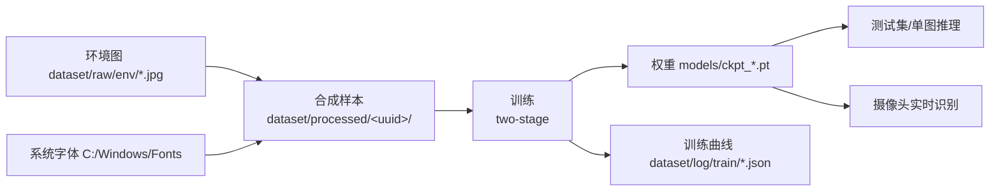

# digits_tracker（增援未来）

用**合成数据**训练的「数字检测」模型：输入一张图，输出图中每个数字的**类型（0~9）**和**四角点坐标**。
支持在一张图里同时检测多个数字（贴纸、标牌、表格里的编号等），也能直接接摄像头做实时识别。

- 模型：`ResNet18` 主干 + 中心点三头（热力图 / 偏移 / 分类），即 CenterNet 结构，输入固定 `384×384`
- 数据：把字体渲染的数字**透视贴到真实环境图的平面区域上**，再做景深失焦与灰度融合，于是标签天然精确、不需要人工标注
- 端到端：合成数据 → 训练 → 评估可视化 → 摄像头实时 → 串口下发（预留）



---

## 1. 五分钟跑通（TL;DR）

前提：已经装好依赖并激活了环境（Conda 或 venv 都行，见第 3 节）。

```powershell
conda activate NNVN        # 非 Conda 用户：换成 .venv\Scripts\Activate.ps1
cd D:\ProgramData\Windows\Desktop\workspace\增援未来\dev

# ① 合成 20000 张训练样本（写到 dataset/processed/<时间戳>/）
python src/cli/dataset_preprocess.py -n 20000

# ② 训练（先冻结 backbone 训 head，再整体微调；权重写到 models/ckpt_<uuid>.pt）
python src/cli/model_trainer.py

# ③ 看训练曲线（读 dataset/log/train/*.json，画图 + 打摘要）
python src/cli/train_plot.py

# ④ 用最新权重在测试集上跑一遍并出可视化图
python src/cli/target_inference.py --limit 8

# ⑤ 打开摄像头实时识别（按 q 退出）
python src/cli/realtime_infer.py
```

每一步都可以单独跑，产物都在 `dataset/` 和 `models/` 下，不会覆盖彼此（文件名带时间戳 UUID）。

---

## 2. 目录结构

```
dev/
├─ configs/                 # 全部可调参数（类形式，导入即从类上读）
│  ├─ path.py               #   路径 + “自动选最新数据集/权重” 规则
│  ├─ training_cfg.py       #   训练超参、DataLoader、早停/降 lr
│  ├─ preprocess_cfg.py     #   合成数据的尺寸、字体、板位、极性、落盘格式
│  ├─ infer_cfg.py          #   推理用哪个权重、是否裁正方形
│  ├─ camera_cfg.py         #   摄像头序号、分辨率、阈值、绘制
│  └─ realtime_cfg.py       #   摄像头预处理（灰度/RGB、插值、预览模式）
├─ src/
│  ├─ cli/                  # ★ 所有命令行入口（也是唯一往控制台打印的地方）
│  ├─ preprocess/           # 合成样本：切平面、贴数字、失焦、融合、统计
│  ├─ training/             # 数据集读取、模型、目标编码、训练循环、曲线绘制
│  ├─ inference/            # 权重加载 + 前向 + 解码（CenterNet 后处理）
│  ├─ serving/              # 摄像头采集 + 推理 + 画面叠加的主循环
│  ├─ hardware/             # 串口通信试验脚本（暂不参与主流程）
│  └─ utils/                # 公共工具：图像、日志、文件、字体、几何、绘图
├─ dataset/
│  ├─ raw/env/              # 原始环境图（jpg），合成样本的背景来源
│  ├─ processed/<uuid>/     # 合成产出：样本图 + labels.json
│  └─ log/                  # 训练记录 train/、曲线 plots/、推理图 infer/、摄像头快照 camera/
├─ models/                  # 训练产出的权重 ckpt_<uuid>.pt
└─ tests/                   # pytest（与 src 结构镜像）
```

约定速记：`src/*` 只做实现、不发控制台输出；**目录创建、日志初始化、打印**统一在 `src/cli/*` 里做。

---

## 3. 环境准备

### 3.1 Python 环境（二选一）

本项目在 **Windows** 下开发，Python ≥ 3.10（开发机为 3.11，torch 2.15 + CUDA 13.4 构建）。
仓库根目录有 `requirements.txt`，**用不用 Conda 都可以**；两种方式装完后，后续所有命令完全一样，
唯一区别只是「激活环境」那一句（把 `conda activate NNVN` 换成自己的激活命令）。

#### 方式 A：Conda（开发机一直在用，最省事）

```powershell
# 已有环境
conda activate NNVN

# 从零创建（按自己显卡的 CUDA 版本装 torch，见 https://pytorch.org）
conda create -n NNVN python=3.11 -y
conda activate NNVN
pip install -r requirements.txt --extra-index-url https://download.pytorch.org/whl/cu134
```

#### 方式 B：非 Conda（venv / virtualenv / 系统 Python + pip）

前提：已装好 **Python ≥ 3.10**（`python --version` 能看到版本就说明 PATH 里有）。

```powershell
cd D:\ProgramData\Windows\Desktop\workspace\增援未来\dev

# 1) 建一个虚拟环境（推荐；名字随意，这里叫 .venv）
python -m venv .venv

# 2) 激活它（PowerShell）
.venv\Scripts\Activate.ps1
#   CMD 用：       .venv\Scripts\activate.bat
#   Git Bash 用：  source .venv/Scripts/activate

# 3) 装依赖（必须先升级 pip，否则老 pip 可能不认 +cu134 这类版本号）
python -m pip install -U pip
pip install -r requirements.txt --extra-index-url https://download.pytorch.org/whl/cu134

# 4) 验证：能打印 True 就说明 GPU 可用
python -c "import torch; print(torch.cuda.is_available())"
```

要点：

- **`--extra-index-url` 不能省**：`requirements.txt` 里锁的是 `torch==2.15.0+cu134`，这种 `+cu134`
  本地版本号只在 PyTorch 官方源上有，默认 PyPI 找不到会报 `No matching distribution found`。
- 只用 CPU 或别的 CUDA 版本：先按 <https://pytorch.org> 给的命令单独装 torch/torchvision，
  再把 `requirements.txt` 里那两行删掉/注释掉，然后 `pip install -r requirements.txt`。
- 如果 PowerShell 阻止激活脚本（`无法加载文件 ... 因为在此系统上禁止运行脚本`）：
  ```powershell
  Set-ExecutionPolicy -Scope CurrentUser RemoteSigned
  ```
  或者干脆不激活，直接用 `.venv\Scripts\python.exe src/cli/model_trainer.py` 这种全路径调用。
- 不想建虚拟环境也可以直接全局 `pip install -r requirements.txt`（不推荐，容易和别的项目冲突）。
- 装了之后**不需要 `pip install -e .`**：所有入口都能用 `python src/cli/xxx.py` 直接跑。
  想给别的项目引用本项目时再 `pip install -e .`（`pyproject.toml` 已配置 src 布局）。
- 想让 `python` 命令在所有目录都指向这个环境：激活虚拟环境后再运行，或用绝对路径
  `.venv\Scripts\python.exe`。

主要依赖及用途：

| 依赖 | 用途 |
|---|---|
| `torch` / `torchvision` | 模型（预训练 ResNet18）、训练、推理 |
| `opencv-python` / `opencv-contrib-python` | 读图（支持中文路径）、几何变换、摄像头、绘制 |
| `numpy` | 数组运算、目标编码 |
| `matplotlib` | 数据集统计图、训练曲线 |
| `rich` | 进度条与彩色控制台输出 |
| `pyserial` | `src/hardware/com.py`（串口试验，可选） |

> 依赖清单就是根目录的 `requirements.txt`（含版本号）；开发/测试用的 `pytest` 也在里面。

### 3.2 需要准备的两份“原料”

1. **环境图**：`dataset/raw/env/*.jpg`，随便什么真实照片（桌面、墙面、纸板、机器表面……）。
   合成样本就是把数字贴到这些图里的平坦区域上。当前仓库自带 168 张。
   没有图时会直接报错：`未找到环境图：...`。
2. **字体**：生成脚本从 `C:/Windows/Fonts` 里按名字挑（`arial.ttf`、`calibri.ttf`、`consola.ttf`、
   `times.ttf`、`verdana.ttf`、`segoeui.ttf` …，见 `src/utils/font_processor.py`）。
   所以**合成数据这一步必须在 Windows 上跑**；训练 / 推理 / 摄像头不限平台。

---

## 4. 分步教程

> 下文命令都假设**已激活环境**（`conda activate NNVN` 或 `.venv\Scripts\Activate.ps1`），且当前目录是仓库根目录。
> 没激活也能跑，用解释器全路径即可，例如 `.venv\Scripts\python.exe src/cli/model_trainer.py`。

### 第 1 步：合成训练数据

```powershell
conda activate NNVN
python src/cli/dataset_preprocess.py                    # 默认 SAMPLE_GEN_NUM = 20000 张
python src/cli/dataset_preprocess.py -n 200          # 先小批量试水
python src/cli/dataset_preprocess.py -n 50 --show   # 额外把中间结果（切分/贴图/融合）存到 dataset/log/preprocess/<uuid>/
```

| 参数 | 说明 |
|---|---|
| `-n/--num` | 生成多少张（默认取自 `PreprocessConfig.SAMPLE_GEN_NUM`） |
| `--show` | 保存调试图（会强制单线程，速度慢，仅调试用） |

产物：

```
dataset/processed/20261125_101500_123/
├─ 00000_0042.png     # 灰度样本（默认 384×384，白纸黑字为主）
├─ ...
└─ labels.json        # 整批标签：{"count": n, "samples": [{image,width,height,objects:[{digit,quad,quad_norm,...}]}]}
```

样本外观由 `configs/preprocess_cfg.py` 控制（数字大小 `AREA_RANGE`、每图数字数 `SAMPLE_DIGIT_RANGE`、
是否画板 `BOARD_*`、极性 `POLARITY_FLIP_RATE`、落盘尺寸 `SAVE_SIZE` 等）。
**改完 `SAVE_SIZE` / 极性等参数必须重新生成数据**，旧数据集不会自动变。

### 第 2 步：训练

```powershell
python src/cli/model_trainer.py
```

会自动：读最新的完整数据集（含 `labels.json`）→ 按比例划分训练/验证 → **两个阶段**训练：

| 阶段 | 做什么 | 轮数 / lr |
|---|---|---|
| 1 `head` | 冻结 ResNet 主干，只训三个输出头 | `EPOCHS_HEAD=15` / `LR_HEAD=1e-3` |
| 2 `finetune` | 解冻主干整体微调 | `EPOCHS_FINETUNE=25` / `LR_FINETUNE=1e-4` |

每轮都会在验证集上算 loss：**保存权重、早停、降学习率全部只看 val loss**（训练 loss 受 Dropout/BN 影响，不能代表泛化）。
最终写入 `models/ckpt_<uuid>.pt` 的是「验证 loss 最好那一轮」的权重，不是最后一轮。

日志形如：

```
Epoch 2/15, Loss: 0.7401, Heatmap: 0.4808, Offset: 0.2184, Classification: 0.0409
  | Val Loss: 0.5855, ... | lr=1.00e-03 | 57.5s, 等数据 2.8s, GPU≈95%  (best)
```

- `等数据` = 这一轮里 GPU 干等 DataLoader 的时间；`GPU≈` ≈ `1 - 等数据/单轮耗时`。
- `(best)` 表示该轮刷新了最好 val loss（权重已更新）；`(no improve k/patience)` 表示连续没变好，达到 `EARLY_STOPPING_PATIENCE` 就早停。

参考耗时（RTX 3060 Laptop，`BATCH_SIZE=48 / NUM_WORKERS=10`，2 万张数据集）：阶段一约 16 min，阶段二约 29 min。

### 第 3 步：看训练曲线

```powershell
python src/cli/train_plot.py                 # 最新一次训练（head + finetune 自动配对）
python src/cli/train_plot.py --list          # 列出所有历史训练记录
python src/cli/train_plot.py --uuid 20261124_205751_346
python src/cli/train_plot.py -f a_head.json -f a_finetune.json
python src/cli/train_plot.py --no-show       # 只存图不弹窗
```

图会存到 `dataset/log/train/plots/train_<uuid>.png`，2×4 面板：
四个 loss 分量（训练实线 / 验证虚线，最优轮打星）、学习率、单轮耗时与等数据时间（堆叠柱）、
GPU 忙的比例、以及一份文字摘要。两阶段用不同颜色，中间虚线是分界。

### 第 4 步：验证效果

```powershell
# 测试集里随便挑 8 张，画 GT(蓝) + 预测(绿)，存到 dataset/log/infer/<uuid>/
python src/cli/target_inference.py --limit 8

# 只看某一张（按索引 / 按文件名包含的字符串）
python src/cli/target_inference.py -i 12
python src/cli/target_inference.py --name 0032

# 用自己拍的照片（没有 GT，只画预测）
python src/cli/target_inference.py -p D:\photos\a.jpg D:\photos\b.jpg

# 调阈值：越高越保守（漏检多、误检少）
python src/cli/target_inference.py --limit 8 --thr 0.4 --topk 20
```

用的是哪个权重由 `configs/infer_cfg.py::InferConfig.SELECT_MODEL_ID` 决定（`"0"` = `models/` 下最新的 `ckpt_*.pt`）。

### 第 5 步：摄像头实时识别

```powershell
python src/cli/realtime_infer.py                        # 默认摄像头 0，阈值 0.3
python src/cli/realtime_infer.py -c 1 --thr 0.4         # 换摄像头 / 调阈值
python src/cli/realtime_infer.py --save                 # 按 s 把画面存到 dataset/log/camera/<uuid>/
python src/cli/realtime_infer.py --rotate 90            # 画面装反了：顺时针转 90°
python src/cli/realtime_infer.py --no-show -n 100       # 不弹窗跑 100 帧（无显示器/自测）
```

运行时按键：`q` / `ESC` 退出，`s` 存快照，`r` / `e` 顺时针 / 逆时针转 90°。

**预览窗口为什么是正方形？** 摄像头给的是 16:9，但模型只吃正方形（居中裁切后再缩放到 384）。
所以默认 `--view crop` 直接显示**裁切后的那一块**，看到的就是模型看到的，检测框也不会错位。
另外两种视图只影响显示：

| `--view` | 窗口内容 | 什么时候用 |
|---|---|---|
| `crop`（默认） | 裁切后的正方形，1:1 | 日常使用 |
| `model` | 缩放到 384 后模型真正的输入（含灰度化） | 排查“人眼看着清楚但模型认错” |
| `full` | 整幅画面，裁切区以外压暗 + 黄框 | 确认裁切范围合不合适 |

### 可选：数据集统计

```powershell
python src/cli/dataset_analyze.py                 # 自动选最新数据集，12 面板总览 + 文字报告
python src/cli/dataset_analyze.py -d dataset/processed/20261123_201022_028
python src/cli/dataset_analyze.py --no-show       # 只存图（dataset/log/analysis/）
```

报告里数字类别分布、每样本数字数、四边形面积/宽高/长宽比、板面面积、中心热力图、depth/sigma 等；
发现「数字太小 / 太大 / 分布不均」就回去改 `configs/preprocess_cfg.py` 重新生成。

---

## 5. 配置速查

| 想改什么 | 改哪里 |
|---|---|
| 数据集/权重用哪个、各目录在哪 | `configs/path.py`（`SELECT_IMGSET_ID="0"` / `InferConfig.SELECT_MODEL_ID="0"` 都是「自动取最新」） |
| 生成多少张、数字多大、几张数字、是否画板、落盘尺寸/格式 | `configs/preprocess_cfg.py` |
| 轮数、batch、学习率、早停、DataLoader 并行度、AMP | `configs/training_cfg.py` |
| 推理权重、是否裁正方形 | `configs/infer_cfg.py` |
| 摄像头序号/分辨率/阈值/绘制 | `configs/camera_cfg.py` |
| 摄像头灰度还是 RGB、插值、预览模式 | `configs/realtime_cfg.py` |

改配置不需要动代码：所有模块都是 `from configs.xxx import XxxConfig` 后读类属性。

---

## 6. 常见问题（FAQ）

**Q：第一次跑就内存暴涨 / 卡死（Commit 几十 G），GPU 却闲着？**
DataLoader 子进程（spawn）会重新 import 主模块，一旦顶层 import 了 torch 就会每个进程多背 1GB+。
本项目已把 `src/cli/model_trainer.py` 顶层限制成标准库、`src/training/dataset.py` 与 `src/utils/image.py`
不在顶层 import torch，正常情况下 `NUM_WORKERS=10` 也只有几百 MB/进程。真不够用就降
`TrainingConfig.NUM_WORKERS`（4~6）或 `BATCH_SIZE`。

**Q：`等数据` 占比很高 / `GPU≈` 只有 20~40%？**
1. `NUM_WORKERS` 太小（0 = 全部在主进程读图，几乎必然卡）；
2. 样本图太大 —— `SAVE_SIZE=(384,384)` 后单张读取从 ~5.7 ms 降到 ~1.1 ms，**改完要重新生成数据集**；
3. `PREFETCH_FACTOR` 被内存预算钳到 1（代码会自动算，预算够就会放开）；
4. 磁盘冷读：第一个 epoch 慢是正常的（页缓存），看第 2 个 epoch 之后的数字。

**Q：训练 loss 掉得很快但实拍效果差？**
合成数据与真实场景的差异是主要瓶颈，按优先级：
① 增加环境图数量与多样性 → ② 加字体（手写体最关键）→ ③ 调 `AREA_RANGE` / `SAMPLE_DIGIT_RANGE`
让数字大小与数量接近实拍 → ④ 关掉 `POLARITY_FLIP_RATE`（默认已是 0，避免黑白反转）。
`python src/cli/target_inference.py -p 你的照片.jpg` 可以快速看差距，不用重训。

**Q：摄像头打不开 / 画面全黑？**
换个序号试试 `-c 1`、`-c 2`；被别的软件（微信、Zoom）占用时会被锁住。
画面方向不对用 `--rotate 90/180/270`。

**Q：为什么实时画面是正方形，看起来“少了两边”？**
这是设计：模型只吃居中裁切的正方形，预览默认显示同一块（`--view crop`）。
想看完整画面加 `--view full`。

**Q：路径里有中文可以吗？**
可以。读图走 `np.fromfile + cv2.imdecode`、写图走 `imencode + tofile`，不依赖 OpenCV 的路径处理。

**Q：只想跑一次快速验证（不训练）？**
`python src/cli/target_inference.py --limit 4` 用的是 `models/` 下现成的最新权重；
或用 `-p 你的图片.jpg` 测单张。

**Q：`configs/path.py` 报找不到数据集？**
`SELECT_IMGSET_ID="0"` 会在 `dataset/processed/` 里找**含 `labels.json`** 的最新目录。
目录里没有 `labels.json` 说明那次生成中断了，重新生成，或在 `configs/training_cfg.py::SELECT_IMGSET_ID`
里直接写死目录名。

---

## 7. 开发

```powershell
conda activate NNVN
python -m pytest                       # 全部测试（约 10s，缺数据集时相关用例自动 skip）
python -m pytest --cov --cov-report=term-missing
python -m pytest tests/serving/test_camera.py -v
```

> 非 Conda 环境：把 `conda activate NNVN` 换成 `.venv\Scripts\Activate.ps1`（或直接用 `.venv\Scripts\python.exe -m pytest`）。

- 测试与源码镜像：`tests/{cli,configs,hardware,inference,preprocess,serving,training,utils}`
- `tests/conftest.py` 提供原地刷新的单行进度条（`PYTEST_LIVE_BAR=1` 可在捕获输出时强制启用）
- VS Code 里也已配置任务：`pytest: 全部测试` / `当前文件` / `上次失败用例` / `覆盖率`
